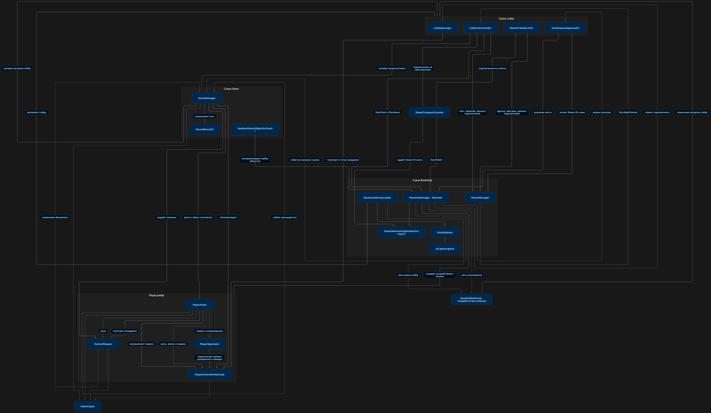

# Hide and Seek

Классические сетевые прятки с маскировкой под предметы. Один игрок становится охотником, остальные прячутся на карте. Прячущиеся могут принять вид предметов окружения и выбрать место, где их сложнее заметить.

## Как проходит раунд

1. Хост создаёт игру в лобби. Друзья подключаются через приглашение Steam или внутриигровой список друзей.
2. Игроки знакомятся с картой. Затем сервер случайно выбирает охотника и даёт остальным время спрятаться.
3. Охотник ищет замаскировавшихся игроков и стреляет по подозрительным предметам. Количество патронов зависит от числа прячущихся. Пойманные игроки переходят в режим наблюдения.
4. Охотник побеждает, если находит всех. Если истекает время или заканчиваются патроны, а кто-то ещё прячется, побеждают прячущиеся. После показа результата игроки возвращаются в лобби.

## Технологии

- **Unity 6 (6000.3.6f1)** — игровой движок.
- **Netcode for GameObjects** — сетевые объекты, синхронизация состояния игроков, RPC и загрузка сцен для всей сессии.
- **Steamworks.NET и SteamNetworkingSocketsTransport** — лобби, приглашения и подключение по Steam ID. Для Netcode for GameObjects в проекте подключён транспорт Steam Networking Sockets из Unity Multiplayer Community Contributions.

## Запуск

Откройте корневую папку проекта в Unity 6000.3.6f1 и дождитесь загрузки зависимостей. Запустите Steam, откройте сцену [Bootstrap](Assets/Scenes/Bootstrap.unity) и нажмите Play. Для раунда нужны минимум два игрока.

## Граф архитектуры

Граф показывает связи между сценами, сетевыми менеджерами и компонентами префаба игрока. Нажмите на изображение, чтобы открыть его в полном размере.

